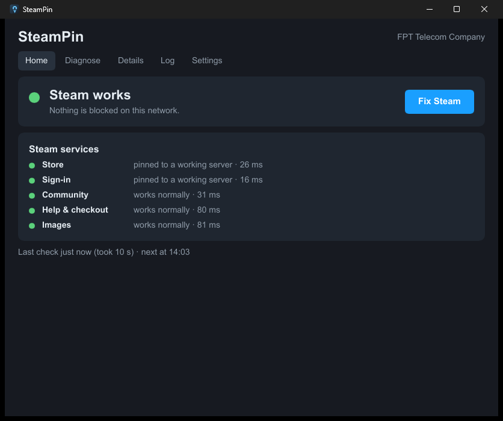
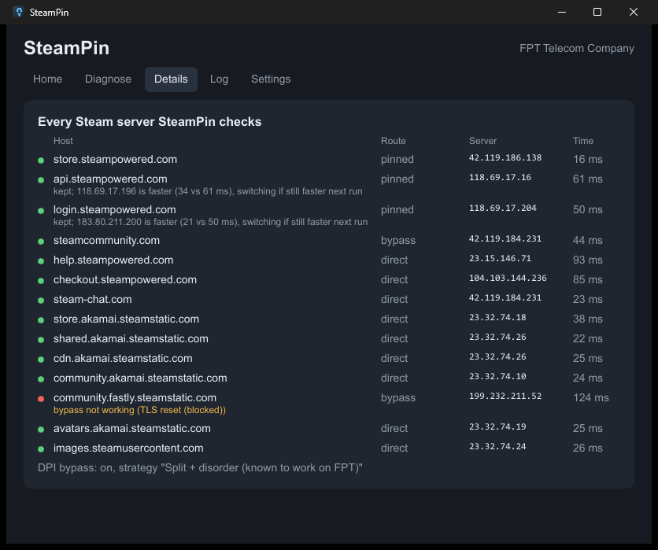

# SteamPin

**Keeps Steam working on networks that block it. One small app (13 MB download, a few MB of RAM) that checks every Steam server for real, picks the route that works, and fixes itself when something changes.**

Built for Vietnam (FPT, Viettel, VNPT), where Steam's store, sign-in and community are blocked by DNS poisoning and TLS resets. Works on any network: it measures what's actually blocked instead of assuming.

> Tiếng Việt: SteamPin tự kiểm tra từng máy chủ Steam và chọn cách vào được: trực tiếp, ghi IP máy chủ tốt nhất vào file hosts, hoặc dùng bộ vượt chặn DPI (zapret) chỉ cho Steam. Tự sửa khi mạng thay đổi. Cài: tải `SteamPin.exe`, mở, bấm **Install**.



## What it does

For each Steam host (store, sign-in, API, community, help, checkout, chat and the image servers), SteamPin finds the first route that really works:

1. **Direct.** Normal DNS gives a working server: nothing to do.
2. **Pinned.** DNS is poisoned or points at a blocked server, but another Steam server works: SteamPin pins the fastest verified one in the hosts file.
3. **Bypass.** Nothing works without help: SteamPin runs [zapret](https://github.com/bol-van/zapret)'s DPI bypass (`winws`) **for Steam only**, after testing about 10 bypass strategies on your network and keeping the best.

"Works" means an HTTPS request with the real host name and a valid certificate, plus a check of the answer (the API must return its `servertime` JSON, sign-in must redirect to Steam). A server that answers ping, or serves an error page or another site, doesn't count.

It keeps checking every 30 minutes, when the network changes and after sleep:

- **Healthy pins stay.** It switches only to a clearly faster server, after two runs in a row.
- **Failing pins are replaced at once.** A failing bypass strategy is re-tested.
- **Repairs itself.** If antivirus wipes the hosts entries, they come back within a minute (a read-only hosts file stays read-only: SteamPin lifts it only while writing). If winws crashes, it's restarted.
- **Restarts Steam for you (optional).** Steam only picks up new servers after a restart. With *Restart Steam automatically* on, SteamPin restarts it after a switch, but never during a game: it waits until you close the game.
- **Offline means hands off.** Nothing changes while there's no internet.

## Diagnose



**Diagnose** checks everything that commonly breaks Steam, in plain words, with a fix button where there is one:

- DNS poisoning.
- A locked hosts file, or antivirus resetting it.
- Bypass files removed by antivirus, or the WinDivert driver blocked.
- Another bypass tool running at the same time (CDPI UI, GoodbyeDPI, another zapret).
- A VPN or proxy that takes Steam elsewhere.
- Browsers whose Secure DNS ignores the hosts file.
- Steam started before the last change (it needs a restart).

**Copy report** gives a text summary to paste when asking for help. It contains no personal data, only Steam's server addresses.

## Install

1. Download `SteamPin.exe` from [Releases](https://github.com/CratusGod/steampin/releases).
2. Open it and click **Install**, then accept the admin prompt.
3. The first check takes about a minute. Restart Steam when it asks.

That's it. It runs as a Windows service with a tray icon. Closing the window doesn't stop it.

- **Upgrading from SteamPin 2:** install over it. The old scheduled task is removed and your pins are kept.
- **Using CDPI UI, GoodbyeDPI or another zapret:** Diagnose offers to close them, because two bypass tools on the same traffic break each other. Uninstall them if Steam was the only reason you had them.
- **Antivirus:** some antivirus flags WinDivert (the network driver zapret uses) as a "RiskTool". If the bypass files disappear, add an exception for `C:\Program Files\SteamPin\zapret` and click **Repair** in Diagnose.

**Uninstall:** Settings → Uninstall, or Windows Settings → Apps. It removes the service, the driver, the hosts entries and all files.

## How light is it

| Part | Memory | When |
|---|---|---|
| Service | ~6 MB | always |
| Tray icon | ~2 MB | always |
| Window | ~5 MB | only while open |

A full check of 14 Steam hosts takes 5–10 seconds, every 30 minutes. The bypass touches only ports 80/443 to Steam host names, so games and everything else are untouched.

## Command line

`SteamPin.exe --status | --check [--full] | --retest | --diagnose | --dry-run | --test | --restart-steam | --unpin | --install | --uninstall`

## Configure

Optional: `C:\ProgramData\SteamPin\config.json` (admins only) overrides the built-in [`assets/default-config.json`](assets/default-config.json): the hosts to check, seed servers, DNS resolvers, bypass domain lists and timings.

## Build

```powershell
.\tools\fetch-zapret.ps1     # official zapret release, hash-checked
cargo test --release
cargo build --release        # target\release\steampin.exe
```

Releases are built by GitHub Actions from a `v*` tag.

## Credits and license

MIT. The DPI bypass is [zapret](https://github.com/bol-van/zapret) (MIT) with [WinDivert](https://github.com/basil00/WinDivert) (LGPL). The UI uses [Slint](https://slint.dev). See [THIRD_PARTY_NOTICES.md](THIRD_PARTY_NOTICES.md).
